<p align="center">
  
</p>

<h1 align="center">SimpleWorship</h1>

<p align="center">
  <b>Put the Word on the screen.</b><br>
  Free, open-source worship presentation software for churches: songs, scripture, media<br>
  and every screen in the building, with no subscription, no account and nothing to pay.<br>
  If you have run EasyWorship, you already know your way around.
</p>

<p align="center">
  <a href="https://github.com/brvhprince/simpleworship/releases/latest"></a>
  
  
  <a href="LICENSE"></a>
  <br>
  <a href="https://sonarcloud.io/project/overview?id=brvhprince_simpleworship"></a>
  <a href="https://coderabbit.ai"></a>
</p>

<p align="center">
  <a href="https://github.com/brvhprince/simpleworship/releases/latest"></a>
</p>

<p align="center">
  <a href="https://brvhprince.github.io/simpleworship/"><b>Website</b></a> ·
  <a href="docs/moving-from-easyworship.md">Moving from EasyWorship</a> ·
  <a href="https://github.com/brvhprince/simpleworship/releases">All releases</a> ·
  <a href="CHANGELOG.md">What's new</a>
</p>

<br>

<p align="center">
  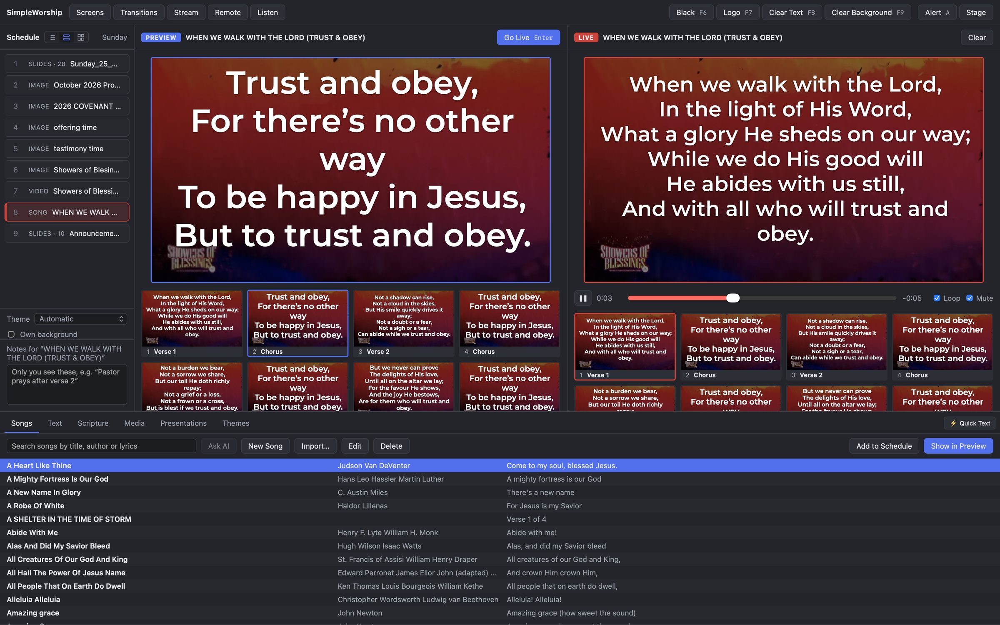
  <br>
  <sub>A Sunday service: the schedule on the left, the next slide in preview, the live slide on the right, and the library along the bottom.</sub>
</p>

<p align="center">
  <a href="#features">Features</a> ·
  <a href="#everything-in-the-box">Everything in the box</a> ·
  <a href="#download">Download</a> ·
  <a href="#keyboard-shortcuts">Shortcuts</a> ·
  <a href="#build-it-yourself">Build it yourself</a> ·
  <a href="#how-it-is-built">How it is built</a> ·
  <a href="#license">License</a>
</p>

<br>

<table>
  <tr>
    <td width="25%" valign="top">
      <h3>⛪ Familiar on Sunday</h3>
      The EasyWorship layout and keys: F6 Black, F7 Logo, C for the chorus. Your songs, Bibles and media come across in one step.
    </td>
    <td width="25%" valign="top">
      <h3>👂 It hears the scripture</h3>
      Turn on Listen, and the passage the preacher reads is waiting one click from the screen. On the computer, offline.
    </td>
    <td width="25%" valign="top">
      <h3>🌍 Made for your church</h3>
      In English, French and Twi, with the KJV, WEB, Asante Twi and Louis Segond Bibles included, and over a thousand more a click away.
    </td>
    <td width="25%" valign="top">
      <h3>🔓 Free, and stays free</h3>
      No subscription, no account, nothing sent anywhere. Open source under the GPL, so it belongs to every church that uses it.
    </td>
  </tr>
</table>

<br>

## Features

<table>
  <tr>
    <td width="50%" valign="top">
      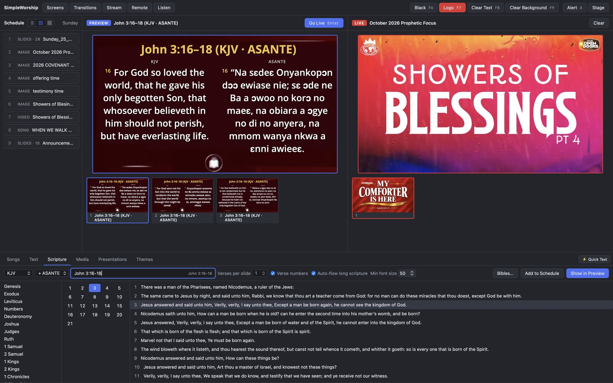
      <br>
      <sub>John 3:16–18 in the KJV and the Asante Twi Bible, side by side.</sub>
      <h3>Scripture as fast as it is said</h3>
      Type a reference the way you would say it (<code>jn 3:16-18</code>, <code>1 cor 13</code>, <code>ps 23</code>) or pick book, chapter and verses. Show two translations side by side. Long passages flow onto the next slide before the words get too small to read, at a minimum size you choose.
    </td>
    <td width="50%" valign="top">
      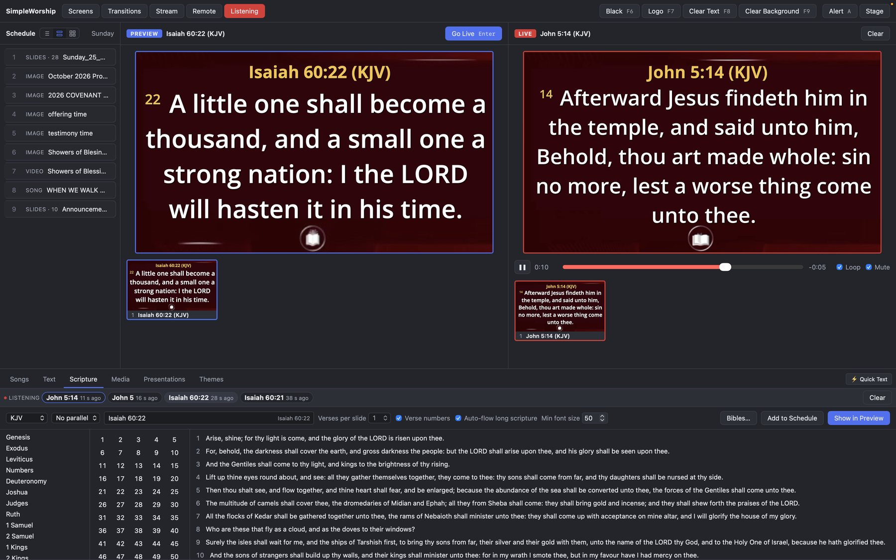
      <br>
      <sub>Every reference the preacher read, waiting at the top of the Scripture tab.</sub>
      <h3>Listen: it hears the preacher</h3>
      Choose the mixer's feed, and every passage that is read ("John chapter five, verse fourteen", "Isaiah 60:22", "verse twenty-one") appears in the Scripture tab. Press <b>H</b> to preview the newest; double-click to send it live. Nothing goes live by itself.
      <br><br>
      Speech to text (Whisper) runs on the computer, so it works offline and no sound leaves the church.
    </td>
  </tr>
  <tr>
    <td width="50%" valign="top">
      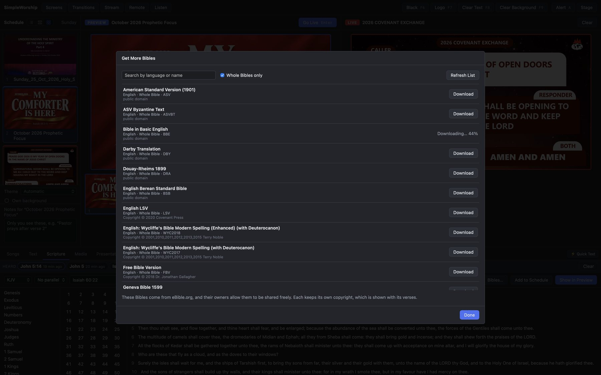
      <br>
      <sub>Get More Bibles: search eBible.org's freely shared translations and download one.</sub>
      <h3>Over a thousand Bibles, a click away</h3>
      The King James Version, the World English Bible, the Asante Twi Bible and the French Louis Segond are included. <b>Get More Bibles</b> downloads any of eBible.org's freely shared translations: over 1,200, in more than 130 languages, including Akuapem Twi.
      <br><br>
      You can also bring Bibles across from EasyWorship, or import OSIS, Zefania, OpenSong, USX and USFM files.
    </td>
    <td width="50%" valign="top">
      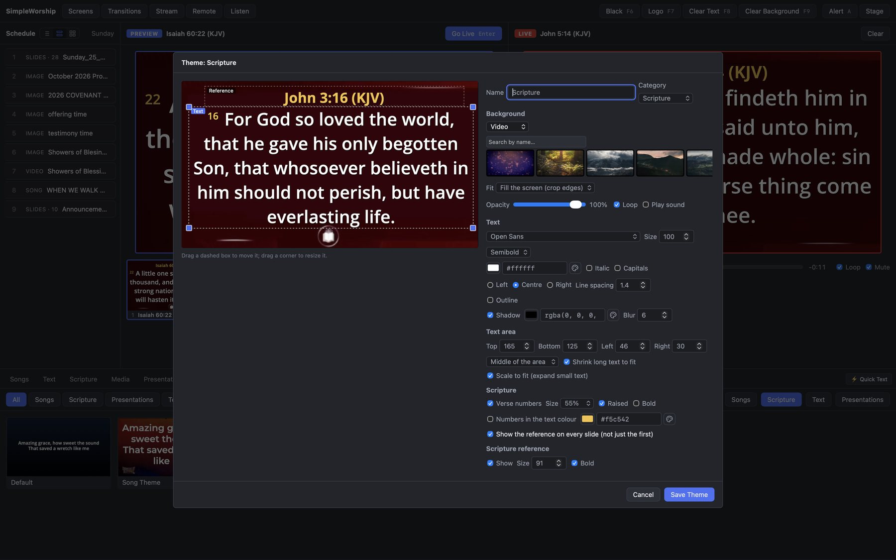
      <br>
      <sub>A scripture theme with a video background, in the theme designer.</sub>
      <h3>Themes that look like your church</h3>
      Fonts, colours, outline and shadow, a text area you drag into place, and a colour, gradient, picture, looping video or live camera behind it. Themes are made for songs, scripture, presentations or text, and show only the settings that matter for each.
      <br><br>
      Short words can grow to fill the screen, and every picture or video keeps its own scaling (stretch, fit or fill) wherever it is used.
    </td>
  </tr>
  <tr>
    <td width="50%" valign="top">
      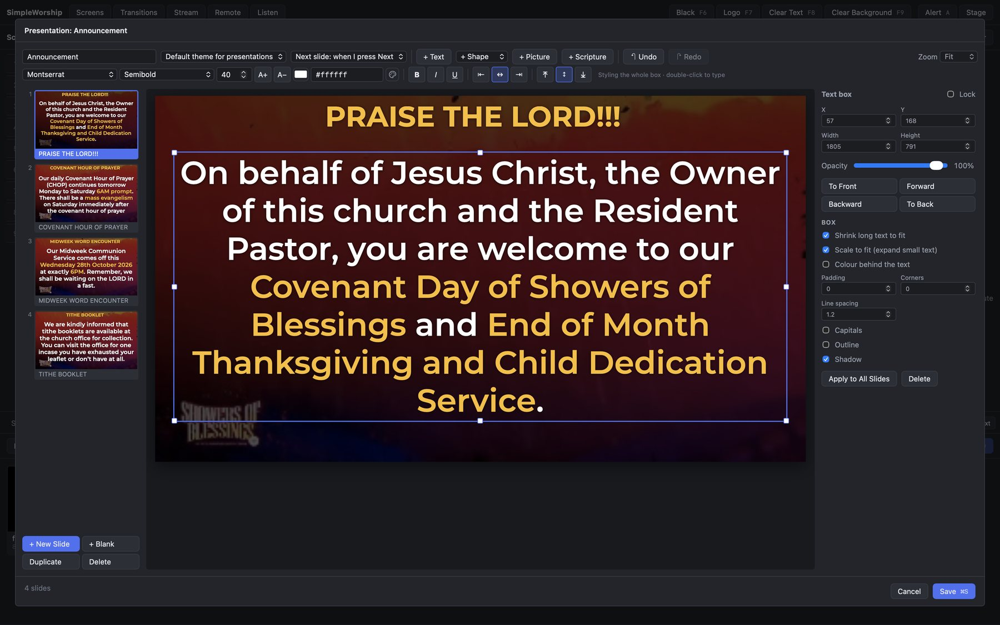
      <br>
      <sub>Announcements in the presentation editor, with some words picked out in gold.</sub>
      <h3>Presentations without PowerPoint</h3>
      A slide editor for announcements, prayer points and sermon notes: text boxes, shapes, pictures and videos anywhere on the slide, with snap guides. Give any words their own font, weight, size or colour. New Slide reuses the layout, so the next prayer point is just typing.
      <br><br>
      PDF slides import page by page, and PowerPoint and Keynote files too when LibreOffice is installed.
    </td>
    <td width="50%" valign="top">
      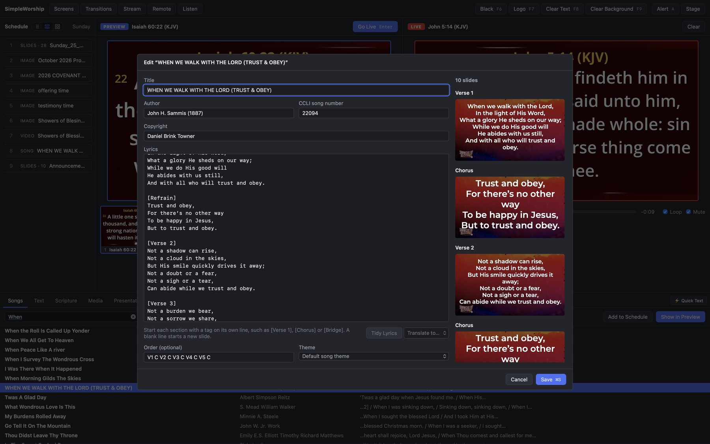
      <br>
      <sub>The song editor, with a preview of every slide.</sub>
      <h3>Songs in two letters</h3>
      Search titles, writers and every line of the lyrics. Jump to a section with a key: <b>V 2</b> for verse two, <b>C</b> for the chorus. Fix a typo mid-service and it is fixed on the screen too.
      <br><br>
      Bring your library across from EasyWorship 6/7, OpenLP, ProPresenter, OpenLyrics, ChordPro and SongSelect. Every song shown is logged for your CCLI report.
    </td>
  </tr>
  <tr>
    <td width="50%" valign="top">
      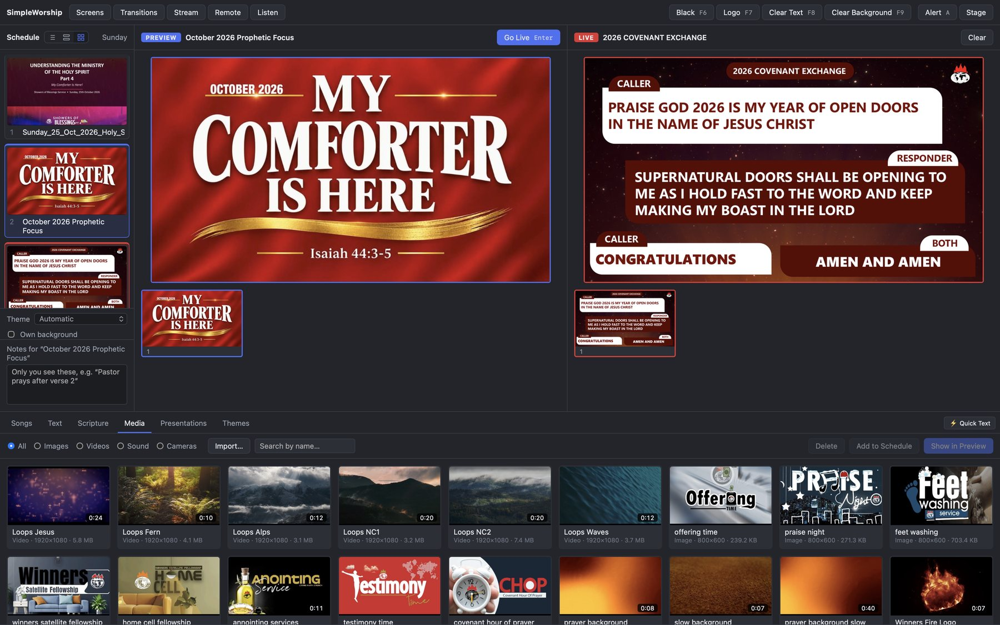
      <br>
      <sub>The schedule as pictures, and the media library below.</sub>
      <h3>Run the service your way</h3>
      Build the order of service by dragging, and see it as a list, as cards, or as pictures of each item's first slide. Next carries on into the next item, and the one after waits in preview. Quick Text is a click away from anywhere.
      <br><br>
      Pictures, looping videos and cameras for backgrounds or on their own, a video as the church logo, and background music with a fade-out.
    </td>
    <td width="50%" valign="top">
      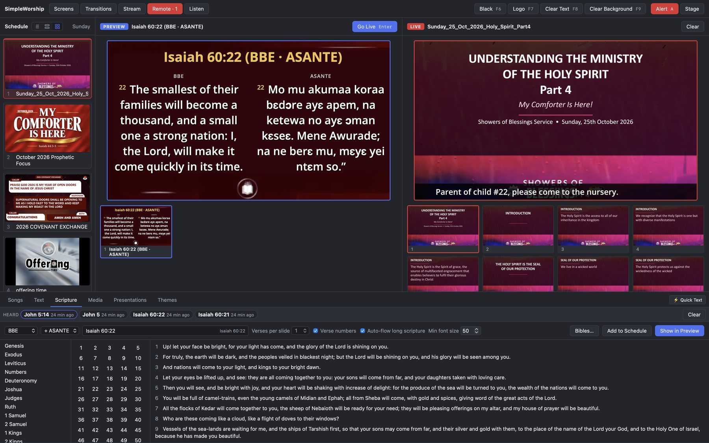
      <br>
      <sub>A nursery alert over the live slide.</sub>
      <h3>Alerts, countdowns and the stage</h3>
      A nursery or car-park message over the slides, scrolling or still; saved templates take a number in one step. Countdowns to the start of the service. A stage display with the speaker's timer and messages only the stage sees.
      <br><br>
      Black, Logo, Clear Text and Clear Background are one key each: F6 to F9.
    </td>
  </tr>
</table>

<br>

### Every screen in the building

<p align="center">
  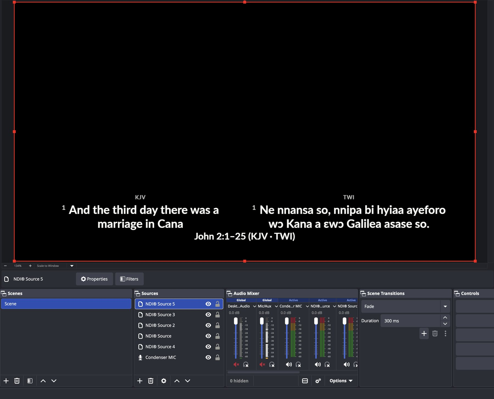
  <br>
  <sub>The livestream look in OBS over NDI: scripture as a lower third on a see-through background, ready to sit over the camera.</sub>
</p>

The projector, a stage display, and a look of its own for the livestream: by default a lower third on a see-through background for OBS, vMix or Streamlabs, as a browser source, a window or <b>NDI</b>. Another SimpleWorship computer can join as a second operator or a mirror, and take over if the first one stops.

<p align="center">
  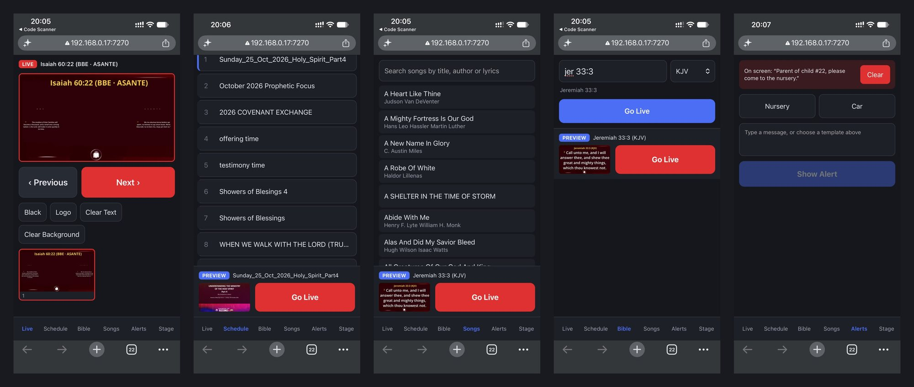
  <br>
  <sub>The phone remote: live controls, the schedule, songs, the Bible and alerts, in the phone's browser.</sub>
</p>

Phones and tablets on the church Wi-Fi become remotes: scan a QR code, nothing to install. Each phone gets a role, from full control to just Next and Previous for the preacher or alerts for the nursery.

<br>

## Everything in the box

<table>
  <tr>
    <td width="33%" valign="top">
      <b>Running the service</b><br>
      Schedules you build by dragging, with notes for the operator<br>
      Next carries on into the next item; the next one waits in preview<br>
      Black, Logo, Clear Text, Clear Background<br>
      Cut or fade, set for each kind of content<br>
      Quick Text from anywhere in the library<br>
      List, card or picture layout for the schedule<br>
      Autosave, and the schedule back after a crash
    </td>
    <td width="33%" valign="top">
      <b>Content</b><br>
      Songs with sections, arrangements and footers<br>
      Scripture in any two translations side by side<br>
      Pictures, videos and cameras as items or backgrounds<br>
      A picture or a looping video as the church logo<br>
      Background music with fade-out<br>
      Countdowns, to a time or for some minutes<br>
      Alerts for the nursery and the car park
    </td>
    <td width="33%" valign="top">
      <b>Around the service</b><br>
      Stage display with timer and messages<br>
      Phone remote with roles, paired by QR code<br>
      Stream output for OBS, vMix and NDI<br>
      Second operators, mirrors and take over<br>
      Portable <code>.sws</code> schedules that carry their themes and media<br>
      CCLI song usage report<br>
      Optional AI assistant with your own key
    </td>
  </tr>
</table>

<details>
<summary><b>The assistant (optional)</b></summary>
<br>

With the church's own API key for Claude (Anthropic), ChatGPT (OpenAI) or Gemini
(Google), kept in the computer's keychain (Settings › Assistant), an AI can help:
**Ask AI** finds songs from a description ("the song about the blood that never
loses its power") and passages on a theme; **Tidy Lyrics** sets out pasted
lyrics in sections; **Translate** drafts a song in Twi, French or English as a
new song; **From Sermon Notes** turns the preacher's outline into slides and
scripture for the schedule. Nothing is sent until a button is clicked, and the
library is never sent.
</details>

<details>
<summary><b>The phone remote's roles</b></summary>
<br>

Turn the remote on under **Remote** in the toolbar, click **Connect a Phone**,
and scan the QR code. Nothing to install: it runs in the phone's browser. You
choose what each phone may do:

- **Full control:** live controls, schedule, songs, Bible, alerts and stage;
- **Presenter:** next and previous slide, sections, Black (for the preacher);
- **Worship leader:** the songs in the schedule only;
- **Alerts:** show and clear alerts (for the nursery and ushers);
- **Stage view:** a stage display on a tablet.

Phones connect only over the local network, never the internet, and the
computer checks every tap against the phone's role. Remove a phone in
Settings › Phone Remote and it is disconnected at once.
</details>

<details>
<summary><b>The stream output and NDI</b></summary>
<br>

The same slides in a look of their own for the livestream, like EasyWorship's
Alternate Output. By default songs and scripture appear as a lower third on a
see-through background, so OBS or vMix shows the camera behind the words;
presentations look as they do on the projector. Black, Logo and Clear Text take
the words off the stream without covering the camera. Use it as:

- a **browser source** in OBS, vMix or Streamlabs (Stream › copy the link;
  1920 × 1080), on this computer or another one on the network;
- a **stream window** on a screen, for a capture card or a video switcher (with
  a green background for chroma key);
- **NDI**, for vMix, OBS (with its NDI plugin), TriCaster and other NDI
  receivers: the source "SimpleWorship Stream", with transparency, and
  optionally "SimpleWorship Main". It needs the free
  [NDI Tools](https://ndi.video/tools/) (or NDI Runtime); macOS and Windows for
  now.
</details>

## Download

Get the installer for your computer from the
[latest release](https://github.com/brvhprince/simpleworship/releases/latest):

| Computer | File |
| -------- | ---- |
| Mac (Apple Silicon or Intel), macOS 11+ | `SimpleWorship_…_universal.dmg` |
| Windows 10 or 11 | `SimpleWorship_…_x64-setup.exe` (or the `.msi` for managed computers) |
| Linux | `.AppImage`, or the `.deb` / `.rpm` for your distribution |

> [!NOTE]
> Until the installers are signed, the system warns the first time: on a Mac,
> right-click SimpleWorship and choose **Open**; on Windows, click
> **More info › Run anyway**.

SimpleWorship looks for new versions and downloads them quietly, but only
installs when you click, and never while something is live. Double-clicking a
`.sws` schedule opens it.

<details>
<summary><b>Videos: which formats play</b></summary>
<br>

SimpleWorship plays videos with the system's own video support, so it needs no
extra codecs on macOS and Windows. **MP4 files with H.264 video and AAC sound
play everywhere** and are the safest choice. Other formats (HEVC, WebM, MOV)
depend on the computer.

On **Linux**, video playback uses GStreamer. Install its codec packages, for
example on Ubuntu or Debian:

```sh
sudo apt install gstreamer1.0-plugins-good gstreamer1.0-plugins-bad gstreamer1.0-libav
```
</details>

<details>
<summary><b>If phones can't connect</b></summary>
<br>

- The phone must be on the **same Wi-Fi** as the computer (not mobile data, and
  not a guest network that keeps devices apart).
- The first time the remote is turned on, **Windows asks whether to allow
  SimpleWorship on the network**: allow it on private networks. If you missed
  it, allow SimpleWorship in *Windows Security › Firewall & network protection
  › Allow an app through firewall*. On a Mac, allow incoming connections if
  asked.
- The remote uses port **7270**. If something else uses it, change the port in
  Settings › Phone Remote.
</details>

<details>
<summary><b>Testing on one screen</b></summary>
<br>

The output opens on the projector automatically at startup when one is
connected, and never steals the keyboard from the operator. With a single
screen, a full-screen output stays *behind* the operator window, and Esc
closes it.
</details>

## Keyboard shortcuts

| Key                                  | Action                                    |
| ------------------------------------ | ----------------------------------------- |
| → ↓ Space PageDown                   | Next slide (into the next item at the end) |
| ← ↑ PageUp                           | Previous slide (into the previous item at the start) |
| Enter                                | Send preview live                         |
| F6 / F7 / F8 / F9                    | Black / Logo / Clear Text / Clear Background |
| V, C, B, P, T, I, E (+ a number)     | Jump to Verse 2, Chorus, Bridge, …        |
| Enter, Enter (in the Scripture tab)  | Preview the passage, then send it live    |
| H (while listening)                  | Preview the newest reference heard        |
| ↑ / ↓ and Delete (in the schedule)   | Preview the previous / next item, remove the item |
| ⌘/Ctrl + N, O, S, Shift+S            | New, Open, Save, Save As schedule         |
| A                                    | Open the Alert panel                      |
| Esc                                  | Clear the alert (in an output window: close it) |
| ⌘/Ctrl + ,                           | Settings                                  |

## Build it yourself

You need:

- [Rust](https://rustup.rs) (stable)
- [Node.js](https://nodejs.org) 22+ and [pnpm](https://pnpm.io) 10+
- The [Tauri system dependencies](https://tauri.app/start/prerequisites/) for
  your OS. On Linux that includes WebKitGTK, and the GStreamer plugins for
  video playback.
- [CMake](https://cmake.org) and libclang, to build Whisper's speech to text
  for Listen:
  - Mac: `brew install cmake` (libclang comes with Xcode's tools).
  - Windows: CMake comes with Visual Studio's C++ tools; for libclang,
    `winget install LLVM.LLVM`, then open a new terminal.
  - Linux: `sudo apt install cmake libclang-dev libasound2-dev` (the last is
    for microphones).

```sh
pnpm install
pnpm dev        # runs the desktop app with hot reload
```

| Command | Does |
| ------- | ---- |
| `pnpm test` | Rust and TypeScript tests |
| `pnpm check` | TypeScript and Svelte type checks |
| `pnpm lint` | Biome and Clippy |
| `pnpm format` | Biome and rustfmt |
| `pnpm gen:bindings` | Regenerate the TypeScript types after changing Rust types |
| `pnpm i18n:check` | Check the translations (add `--sync` after adding English text) |
| `pnpm build` | Build the installers for your platform |

Contributions are welcome: see [CONTRIBUTING.md](CONTRIBUTING.md). To help
translate, see [Translating SimpleWorship](packages/i18n/src/messages/README.md).

## How it is built

SimpleWorship is a [Tauri 2](https://tauri.app) app: a Rust core with a
[Svelte 5](https://svelte.dev) interface.

```
crates/
  sw-core/      Domain model and the presentation engine (pure Rust, no I/O)
  sw-db/        SQLite library storage with full-text search
  sw-files/     SimpleWorship's own file formats (.sws schedules)
  sw-bible/     Bible books, reference parsing, and Bible file importers
  sw-import/    Song importers for other worship software
  sw-listen/    Listen: microphone capture and Whisper, in a helper process
  sw-server/    The phone remote's server: pairing, roles, WebSocket, media
  sw-ndi/       NDI output: the NDI runtime, pictures of a webview, fades
apps/
  desktop/      The Tauri app: operator window, output and stage windows
  remote/       The phone remote: a web app the desktop serves on the network
packages/
  i18n/         Translations, shared by the desktop and the remote
  protocol/     TypeScript types generated from Rust, plus the Transport interface
  renderer/     Svelte components that draw slides (output, previews, thumbnails)
  ui/           Shared Svelte components and design tokens
```

The **Rust core owns all state.** Windows never change anything themselves.
They send a `Command` to the engine, and every window updates from the
`EngineEvent`s that come back. The phone remote, a joined computer and the NDI
output are more clients of the same engine.

Slides are laid out on a fixed 1920×1080 canvas and scaled to fit, so the
projector, the stage display, the stream and every thumbnail look the same.

<details>
<summary><b>Roadmap</b></summary>
<br>

| Milestone | Scope | Status |
| --------- | ----- | ------ |
| M0  | Monorepo, tooling, CI | ✅ |
| M1  | Output engine, monitors, live controls, transitions | ✅ |
| M2  | Song library, editor, search, preview → live | ✅ |
| M3  | Schedules: build, save/open, run a service | ✅ |
| M4  | Scripture: Bible import, reference entry ("jn 3:16-18"), versions | ✅ |
| M5  | Theme designer, image/video backgrounds, media library, per-item overrides | ✅ |
| M6  | Importers: EasyWorship 6/7, OpenLP, OpenLyrics, ProPresenter, ChordPro, CCLI | ✅ |
| M7  | Alerts, countdowns, background audio, presentations (PDF/PPTX), CCLI report | ✅ |
| M8  | Presentation editor, slideshows, scripture styling | ✅ |
| M9  | Installers, auto-update, translations (English, French, Twi), EasyWorship media import | ✅ |
| M10 | Phone remote, per-content transitions | ✅ |
| M11 | Stream output, browser source, stream window, NDI, cameras | ✅ |
| M12 | More than one computer: second operators, mirrors, take over | ✅ |
| M13 | AI: Listen for scripture (on the computer), and an optional assistant | ✅ |
</details>

## License

SimpleWorship is free software, released under the
[GNU General Public License v3.0 or later](LICENSE).

The name “SimpleWorship” and its logo are trademarks of Prince Takyi Akomea.
The licence covers the code, not the name: a changed version must use its own
name and logo, and SimpleWorship may not be sold under its name. Talking about
it, teaching it and sharing the official releases are always welcome. See
[TRADEMARKS.md](TRADEMARKS.md).

The included Bibles keep their own licences: see
[Bible licensing](resources/bibles/README.md). NDI® is a registered trademark
of Vizrt NDI AB; SimpleWorship does not include NDI, it uses the NDI Runtime if
you install it.
